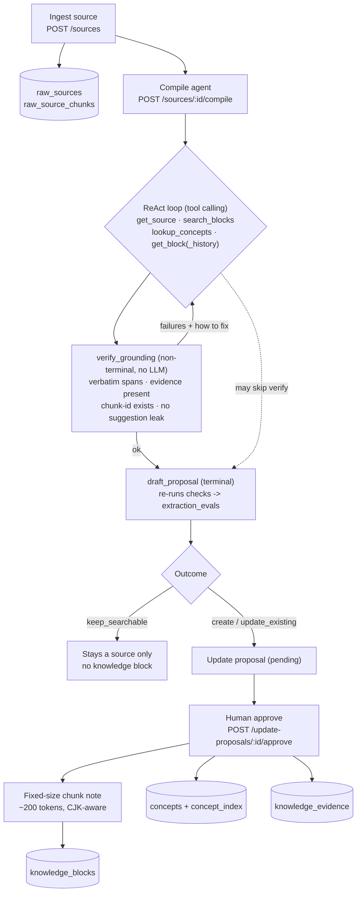

# Knowledge Compiler

An agentic note-taking workflow. As you write notes, an agent uses tool calling to
search your past notes and propose how to fold the new material into them
(create, update, or keep as a plain source). Nothing enters your knowledge base
until you approve it in the review queue.

## Stack

- Client: React, Vite, TypeScript
- Server: Express, TypeScript
- Database: self-hosted PostgreSQL 16 (plain image, full-text search)
- DB access: `postgres` with hand-written SQL
- Agent runtime: OpenAI Agents SDK

## Local Setup

Install dependencies:

```bash
npm install
```

Create local env files if they are missing:

```bash
cp .env.example .env
cp client/.env.example client/.env
cp server/.env.example server/.env
```

Start Postgres:

```bash
docker compose up -d postgres
```

Apply migrations:

```bash
npm run migrate
```

Run the API:

```bash
npm run dev:server
```

Run the client:

```bash
npm run dev:client
```

The client runs on `http://localhost:5173`.

The API runs on `http://localhost:4000`.

To populate a dev corpus through the real ingest -> compile -> approve pipeline
from `seed-notes/`:

```bash
npm run seed --workspace=server -- --yes
```

> If you previously ran the ParadeDB image (`paradedb/paradedb`), recreate the
> volume once so Postgres starts on the plain image:
> `docker compose down -v && docker compose up -d postgres && npm run migrate`.

## System Architecture

Raw **sources** are preserved verbatim. An agent compiles each source into an
update proposal; once a human approves it, the proposal lands in the canonical
**knowledge** corpus that `/search` and `/ask` read from.

### Storage

| Tier | Tables | Role |
| --- | --- | --- |
| Source (provenance) | `raw_sources`, `raw_source_chunks` | Original ingested content, kept verbatim. Never destroyed. |
| Knowledge (canonical) | `knowledge_sources`, `knowledge_versions`, `knowledge_blocks`, `compiled_notes` | Deduped, versioned, retrievable knowledge. |
| Concepts | `concepts`, `concept_index` | LLM-extracted concept names used to recall related notes. |
| Provenance | `knowledge_evidence` | Ties knowledge back to the source spans it came from. |

### Compile flow: ingest -> compile -> human review

The compile agent runs a ReAct loop over a small set of tools, then drafts a
proposal. Before submitting, it can call the non-terminal `verify_grounding` tool
to pre-flight its citations against deterministic checks and self-correct. The
terminal `draft_proposal` re-runs the same checks and records them
(`extraction_evals`); a per-item verdict gates apply in the Review Queue.



### Retrieval

`/ask`, `/search`, and the agent's `search_blocks` tool retrieve over
`knowledge_blocks` by fusing Postgres full-text search with concept-index matches
using Reciprocal Rank Fusion (`k=60`). `/ask` answers only from the retrieved
blocks and cites them; if no knowledge matches it falls back to raw source chunks,
labeled as source provenance.

### Design philosophy

- **Two tiers.** *Provenance* (keep originals) and *canonicalization* (be
  authoritative) are separate. Sources are preserved; knowledge is the curated,
  deduped layer.
- **Human-in-the-loop gates the corpus.** Nothing enters `knowledge_blocks`
  without an approved proposal.
- **Agentic judgment protects quality.** The compile agent's keep / create /
  update / conflict decision keeps personal notes, TODOs, and contradicted drafts
  out of the authoritative corpus.
- **Plain Postgres.** Full-text search plus a concept index; no extensions or
  external search services.

## Server Architecture

The server follows a clean architecture-style folder split:

```text
server/src/controllers   HTTP request/response adapters
server/src/routes        Express route registration and route middleware
server/src/services      Application use cases and business flow
server/src/repositories  Persistence interfaces and SQL-backed implementations
server/src/domain        Shared domain types
server/src/middleware    Cross-cutting Express middleware
server/src/validators    Boundary validation schemas
server/src/db            Postgres client and migration runner
server/db/migrations     Versioned SQL migrations
server/tests             Service and validation tests
```

Routes should stay thin. Controllers should translate HTTP calls into service calls. Services should not contain raw SQL. Repositories own database queries.
